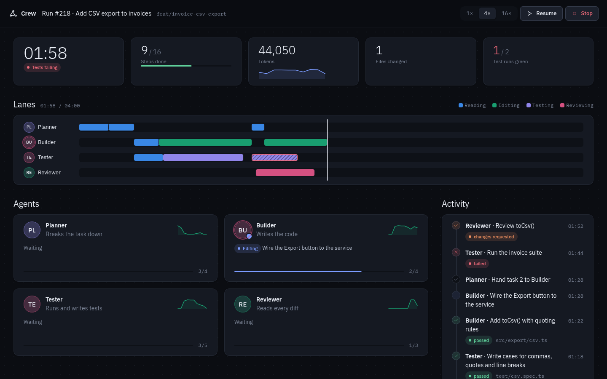
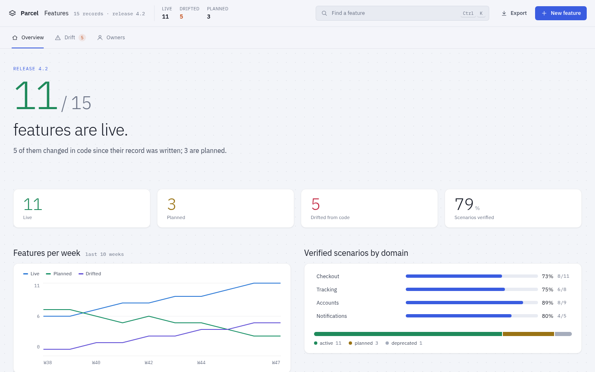
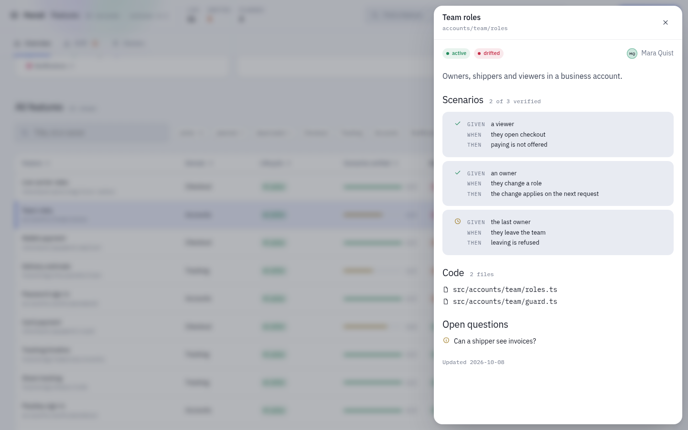
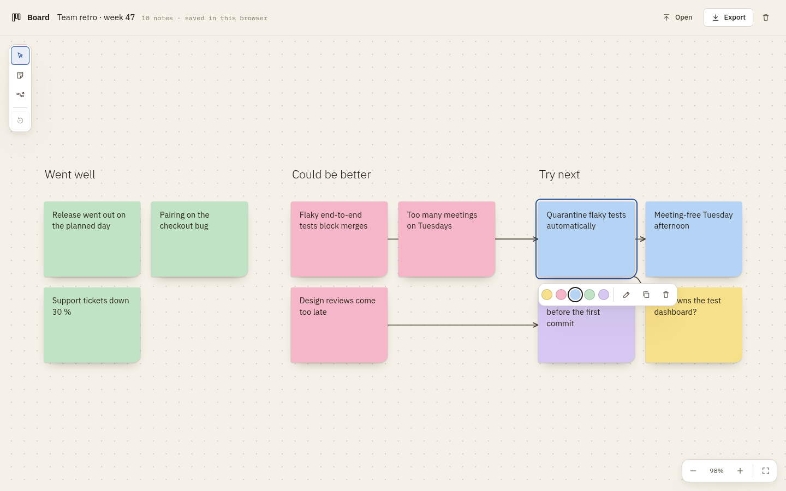

# FACET UI

React components, design tokens, layouts, charts and localization. Version 0.1.0-rc.3.

```sh
npm install @facet-tools/ui@0.1.0-rc.3 react react-dom
```

## What you can build with it

Three complete apps live in [`examples/`](examples). Each one is a small Vite project that
uses only the published package entries.

### Agent run

A live view of several AI agents working on one task: swimlanes of every step, the
current step per agent, token use and an activity timeline. The run replays on a clock.



### Feature overview

A product manager's view of a feature registry: how many features are live, how far code
has drifted from the records, verified scenarios per domain, and every feature in a
sortable, filterable table. A row opens the record with its Given/When/Then scenarios.





### Sticky board

A local whiteboard for notes: pan and zoom, drag notes, connect them with arrows, change
colours, undo. The board is stored in the browser and exports to and imports from JSON.



Run them from a clone:

```sh
pnpm install
pnpm build            # the examples use the built package
pnpm examples:dev     # agent-run, feature-overview and sticky-board on their own ports
```

## Getting started

```tsx
import { AppBar, AppShell, Button, Page, Stack, TextProvider } from "@facet-tools/ui";
import "@facet-tools/ui/styles.css";

export function App() {
  return (
    <TextProvider locale="en">
      <AppShell
        theme={{ theme: "facet", mode: "dark" }}
        top={<AppBar brand="Acme" title="Workspace" actions={<Button>Share</Button>} />}
      >
        <Page>
          <Stack gap={4}>
            <Button variant="primary" onClick={() => alert("Saved")}>
              Save
            </Button>
          </Stack>
        </Page>
      </AppShell>
    </TextProvider>
  );
}
```

The design system is set in IBM Plex Sans and IBM Plex Mono and falls back to the system
fonts. To get the intended look, load both families, for example with
`@fontsource/ibm-plex-sans` (weights 300–600) and `@fontsource/ibm-plex-mono` (400).

Themes: `facet` and `paper`, each `dark` and `light`, chosen with `AppShell`'s `theme`
prop or `data-t-theme` / `data-t-mode` on any ancestor.

## What is in the package

| Area     | Components                                                                                                                                                                                     |
| -------- | ---------------------------------------------------------------------------------------------------------------------------------------------------------------------------------------------- |
| Frame    | `AppShell`, `AppBar`, `NavBar`, `MobileTabBar`, `MoreSheet`, `HistoryNav`, `HistoryMenu`, `AreaBar`, `TabPanel`, `Page`, `Stack`, `Row`, `Grid`, `Section`, `Surface`                          |
| Controls | `Button`, `ConfirmButton`, `IconButton`, `Switch`, `Segment`, `Tabs`, `Chip`, `Badge`, `Kbd`, `Toolbar`, `ColorSwatches`                                                                       |
| Forms    | `Field`, `TextInput`, `TextArea`, `Select`, `SearchField`                                                                                                                                      |
| Data     | `DataTable`, `Collection`, `CollectionToolbar`, `Pagination`, `ListRow`                                                                                                                        |
| Figures  | `Finding`, `Metric`, `Meter`, `RingMeter`, `Distribution`, `ShareBar`, `Sparkline`, `BarChart`, `LineChart`, `BandChart`, `CalendarHeatmap`, `DateHistogram`, `Sunburst`, `Treemap`, `Pyramid` |
| Activity | `Avatar`, `Timeline`, `Spinner`, `Toast`, `ToastRegion`, `EmptyState`, `ErrorState`, `LoadingState`, `OfflineState`, `Skeleton`                                                                |
| Overlays | `Sheet`, `Dialog`, `Menu`, `Tooltip`, `Breadcrumbs`                                                                                                                                            |
| Language | `TextProvider`, `useText`, `createText`, English and German dictionaries                                                                                                                       |

`@facet-tools/ui/primitives` exports a separate set of presentational components with
their logic wrappers. `@facet-tools/ui/tokens` exports typed color, spacing, motion and
typography tokens; `@facet-tools/ui/tokens.css` supplies their CSS variables.

Charts take their series colours from `--t-series-1` … `--t-series-4`, an order chosen
to stay distinguishable under common colour-vision deficiencies. A `null` value is drawn as a gap or
written as "not measured", never as zero.

[Source](https://github.com/facet-framework/facet-ui) ·
[Issues](https://github.com/facet-framework/facet-ui/issues) ·
[Contributing](CONTRIBUTING.md) · [Security](SECURITY.md)

Licensed under Apache-2.0. See [LICENSE](LICENSE), [NOTICE](NOTICE) and
[third-party dependencies](THIRD_PARTY.md).
